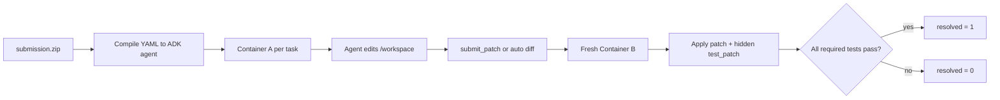

# Gemma 4 Developer Agent — End-to-End Playbook

**Purpose:** one working document for going from zero to a scored, competitive submission in the Kaggle *Google — The Gemma 4 Developer Agent Competition*, including a source-verified post-training plan for a **4×A100 40 GB** remote box plus Kaggle free GPUs.

**Status:** competition is live; entry/team-merger deadline **2026-11-25**, final submission **2026-12-02** (S1). The public leaderboard top is **0.24**; a large cluster is at **0.22** (S4). A public prompt-only notebook *claims* **0.24 public** (S36); treat that exact score as author-reported, not independently verified. Post-training is an optimization, not a prerequisite.

**Evidence rule:** every non-obvious claim is cited as `[S#]`, with line references for the local harness/notebook (`[S5:NNN]`, `[S6:NNN]`). `docs/SOURCES.md` is the claim ledger. Estimates are labeled `[ESTIMATE]`; community results are labeled `[COMMUNITY]`.

---

## 1. Read this first

If you only have one hour:

1. Read this README.
2. Read `docs/00-competition.md` and `docs/01-harness-and-evaluation.md`.
3. Run the public prompt-only configuration (author-reported 0.24; `docs/02-agent-engineering.md` §2) on 2–5 public tasks.
4. Read `docs/05-risks-and-blockers.md` before spending a submission slot.

If you are going to post-train:

1. Read `docs/03-post-training.md` completely.
2. Run its 10-step smoke tests on the 4×A100 box before any long run.
3. Use `docs/06-experiments-and-tracking.md` to record every run.

---

## 2. The shortest correct mental model

The competition is **not** “train a model and submit weights.” You submit a declarative agent bundle. Kaggle serves one fixed Gemma 4 QAT W4A16 model on 4×L4 and runs your agent against about **120 hidden Python issues from private repositories** (S1, S2). Your score is the fraction of issues whose hidden tests pass after applying your agent’s patch (S1).

$$
\text{score} = \frac{\#\{\text{tasks resolved}\}}{\#\{\text{tasks evaluated}\}}
$$

The pipeline is:

The agent has **12 hours total** for patch generation across all tasks, including sandbox setup but excluding patch validation (S1). Participants report that exceeding the global limit produces a timeout with **no partial score** (S29). A task is resolved only if pytest exits 0 and the JUnit report has passed tests, no failures/errors, and every required test node passed (S5:565-567). Test/config edits are stripped and reset (S5:535,549,556).

---

## 3. What you can control

| Lever | What it means | Evidence |
|---|---|---|
| Agent scaffold | Single agent vs sub-agents, tool set, prompt, budget discipline | S5, S36–S38 |
| Budget allocation | `max_time_minutes`, `max_tool_calls`, `max_turns`, thinking budget, output cap | S5:493-509, S36–S38 |
| Model | 31B / 12B / E4B / E2B, one base model per submission | S1, S5:155-173 |
| LoRA adapter | Optional PEFT adapter per agent; same base model; <3 GiB total | S5:191-201 |
| Skills | Sandboxed `SKILL.md` directories with scripts/resources | S5:63-82, S5:130 |
| Data/training | SFT on trajectories, quality filtering, distillation, RL | S10–S20, S25 |
| Submission strategy | One/day, up to two final; public/private split; queue timing | S3, S4, S30 |

You do **not** control the base weights, the serving stack, the hidden tests, the 32k context, or the 4×L4 hardware. Do not plan around changing them.

---

## 4. Recommended path for your compute

You have **4×A100 40 GB** remote plus Kaggle free GPUs. The local workstation has no NVIDIA GPU, 15 GB RAM, and 57 GB free disk, so all training must be remote. Kaggle free GPU quota is nominally ~30 h/week and can vary; L4x4 consumes it at 2× (S42, S1), so one 12 h L4x4 rehearsal costs about 24 h of quota. Budget one rehearsal, not repeated iteration.

### Path A — Prompt-only baseline (must do first)

- **Day 0: submit a probe.** Package the public prompt-only files (S36) and upload the zip before building any local infrastructure. This is the only real test of the submission mechanism; it costs one daily slot and zero final slots. Do not wait for local evaluation.
- **Primary budget: 5 min/task, 24 calls, 240 s command timeout, 8192 output, thinking 2048.** The public 8-min/28-call/4096-thinking config is the reference and an A/B experiment, not the default: its measured mean is ~5.4 min, and 120 × (5.4 + setup) can approach or exceed 12 h (S34, S29).
- Validate on 2–5 tasks, then a 20–40 task holdout. Measure `agent_p50`, `setup_p50`, patch rate, first-edit call, and projected global time.
- Submit one prompt-only bundle early. This is your safety net and your comparison baseline.
- Expected outcome: a scored run in roughly the 0.06–0.24 public range, depending on scaffold and variance (S34/S35/S39/S40). A valid score is the goal; 0.24 is not guaranteed.

### Path B — 31B LoRA/QLoRA on 4×A100 40 GB (main post-training bet)

- Train on successful trajectories from the 31B agent, with thinking traces matching inference.
- **Measure the per-call token-length distribution before choosing a sequence length.** If p95 ≤ 8k, single-GPU 31B QLoRA at 8k is plausible. If p95 is 7k–17k, do not train at 4k; use 8k–16k with FSDP2 BF16 LoRA, or truncate only at turn boundaries.
- **GPU allocation:** serving/eval on GPU 0 (or 0–1 with TP=2); training on GPUs 2–3 (parallel single-GPU QLoRA) or all four with FSDP2 while serving is paused. Do not co-locate FSDP training and the 31B server on the same GPUs.
- Export one adapter, **rank 16**, alpha 16 as the conservative default. Sweep **scale 0.5/1.0** (alpha 8/16); alpha 32 (scale 2.0) is a diagnostic only, because it is the documented degenerate point at rank 16 (S25). If you use rank 8, sweep alpha 4/8.
- Validate on the exact `-qat-w4a16-ct` base in vLLM; prove the adapter changes outputs; measure KV cache and startup.
- Submit the adapter only after it passes A/B, has a hidden score, and wins a paired holdout with ≥8 discordant pairs and ≥75% wins. Keep the prompt-only bundle as the second final submission until then.

### Path C — E4B small-model bonus (cheap hedge)

- $10,000 bonus for the best E2B/E4B entry; LoRA allowed; cross-eligible for main/paper (S47).
- **A probe costs one daily submission slot, not a final slot.** Only selecting it for final judging costs a final slot. Run at most one prompt-only E4B probe in week 2; do not train E4B unless the 31B line fails.
- E4B LoRA trains on ~17 GB per Unsloth (S10), so one A100 40 GB is enough if you do train.
- Best small-model public score was ~0.06 as of 2026-10-20 (S47). The bar is lower, but the model is weaker (S34).
- Decide selection on Dec 1 from scores; do not sacrifice a strong 31B slot for a speculative E4B run.

### Path D — Paper track (parallel, with a hard decision date)

- Separate competition, **$35,000**, deadline **2026-11-12**, 3,000 words, unpublished/non-archival (S46).
- **Decide by Nov 1.** Scope the paper to evidence that exists by then: budget-fit vs global timeout, evaluator drift, local-to-hidden transfer, or graph-tool utility. Do not plan a LoRA case study that depends on week-4 results.
- If yes, cap it at 8 working days and submit by Nov 10. It does not consume a main-track submission slot, but it does consume your time; it is not free.

---

## 5. Dated execution calendar

The competition ends **2026-12-02**. Starting **2026-10-24**, that is 39 days, not six full weeks. Use dates, not week numbers.

| Window | Goal | Hard gate / deliverable |
|---|---|---|
| **Oct 24–30 (W1)** | Join/accept rules; submit the public prompt-only probe; build the A100 harness; build/load `swebench-sandbox`; one task end-to-end | Probe queued/scored; rules accepted; entry confirmed; one task produces a patch |
| **Oct 31–Nov 6 (W2)** | Calibrate 10–15 tasks (≥90% gold, 0 empty); failure taxonomy on 30 failed traces; 5-min/24-call vs 8-min/28-call (reference) paired test | Calibration gate; top two failure classes converted to prompt rules; second submission |
| **Nov 7–13 (W3)** | Trajectory generation (2 temperatures if time-pressed); dataset card; 10-step training smoke test; **one Kaggle L4x4 full-stack rehearsal** | Smoke test fits; L4 timing recorded; paper decision/submission by Nov 10–12 |
| **Nov 14–20 (W4)** | First adapter; A/B; rank/alpha sweep; paired holdout; adapter submission if it wins | Adapter passes A/B + ≥8 discordant/≥75% win; hidden score by Nov 20 |
| **Nov 21–27 (W5)** | One structural change; E4B probe or paper follow-up; diverse second finalist; entry/merger by Nov 24 (official Nov 25; one day margin) | Two scored finalists; entry confirmed; no new experiments after Nov 24 |
| **Nov 28–Dec 1** | Freeze; validate both finalists; select both; no pending runs | Selection confirmed; known-good bundles backed up |
| **Dec 2** | Buffer only | Do not upload on the last day |

The competition is noisy: [COMMUNITY] identical files have scored 0.12–0.22 public in one study (S34), and the same zip scored 0.10 and 0.15 in one period (S39). Plan for 6–10 scored runs, not one perfect run. Submit every 36–48 h when you have a meaningful change; do not hold slots for an unvalidated idea.

## 6. Non-negotiable rules

1. **One base model per submission.** All agents must declare the same allowed Gemma 4 QAT model (S1, S5:170-173).
2. **`agent.yaml` at the zip root.** Exactly one root config; no symlinks; allowed extensions only; unpacked size <3 GiB (S5:84,115,130).
3. **No arbitrary Python entrypoint.** The bundle is declarative YAML; custom tools are the nine built-ins; skills are sandboxed (S5:57,341).
4. **Do not edit tests or runner config.** Those hunks are stripped in Phase 1 and paths are reset in Phase 2 (S5:535,549,556).
5. **Scratch files go in `/tmp`.** Anything in `/workspace` enters the patch (S5:625).
6. **Call `submit_patch()` last.** It is free and terminates the loop after the turn (S5:363-370,627).
7. **Respect the global 12h limit.** A timeout can lose the whole submission (S1, S29).
8. **External data must be public/equally accessible, or meet the Reasonableness Standard.** Winners must provide training code and details; winning code is Apache 2.0 (S3).
9. **One submission/day, up to two final.** Queue delays can consume a slot; submit early (S3, S30).

---

## 7. What usually goes wrong

| Failure | Why | Mitigation |
|---|---|---|
| `NO_PATCH` | Sample budgets are 1 min/10 calls; agent never edits | Use 5 min/24 calls or measure your own; 8 min/28 calls is a fallback; require an edit by call 12 (S6, S36–S38) |
| Global timeout | 120 tasks × per-task cap + setup exceeds 12h | Measure mean/p95; keep mean near 5 min; cap per-task; leave margin (S29, S39) |
| Adapter loads but does nothing | vLLM Gemma 4 LoRA bug / wrong base revision | A/B output at temperature 0; use fixed vLLM; pin base revision (S23) |
| Adapter startup OOM | LoRA CUDA graphs not budgeted; KV cache drops | `VLLM_MEMORY_PROFILER_ESTIMATE_CUDAGRAPHS=1`; one adapter; low rank (S26, S27) |
| LoRA degenerate loops | `alpha/r` too high (e.g. 32/16 = 2.0) | Rank 16; sweep alpha 8/16 (scale 0.5/1.0); alpha 32 is a negative control (S25) |
| Training/inference mismatch | Training data has no thinking, inference uses 4096 | Generate with the same thinking mode; include thought tokens (S25, S8) |
| Local score lies | Plain notebook gold patches fail; missing wheels | Calibrate with gold patches; use scorer-like sandbox (S31, S32) |
| Public LB overfit | Public 50%; final private 50%; noise ±2 tasks | Paired local eval; two diverse final submissions (S4, S34, S35) |
| Patch applies but tests fail | Wrong localization/edge cases; test edits stripped | Fix source; read caller/test; verify targeted tests (S5, S36) |
| Queue/infra failure | 14–33h queue; vLLM startup errors; daily slot lost | Submit early; monitor; keep a known-good bundle (S30) |

Full risk register: `docs/05-risks-and-blockers.md`.

---

## 8. Document map

| File | What it answers |
|---|---|
| `docs/00-competition.md` | What the competition is, tracks, prizes, dates, dataset, leaderboard, rules |
| `docs/01-harness-and-evaluation.md` | Exact submission contract, tools, budgets, patch lifecycle, verification, local CLI |
| `docs/02-agent-engineering.md` | Agent architecture, prompt patterns, budget allocation, sub-agents, skills, public prompt-only config |
| `docs/03-post-training.md` | Data generation, trajectory format, LoRA/QLoRA, 4×A100 recipes, adapter export/validation, RL, blockers |
| `docs/04-runbook.md` | Step-by-step commands from preflight to final submission |
| `docs/05-risks-and-blockers.md` | Full risk register with detection/mitigation/evidence |
| `docs/06-experiments-and-tracking.md` | Metrics, splits, paired comparisons, run manifest, decision rules |
| `docs/07-paper-and-small-model.md` | Paper-track and small-model-bonus strategy |
| `docs/SOURCES.md` | Claim ledger with URLs, line references, confidence labels |
| `docs/_research/` | Raw fact sheets from the local harness README and notebook (not the polished guide) |

---

## 9. The one-paragraph strategy

Build a prompt-only 31B agent that edits early, respects the 24-call/5-minute primary budget (8/28 as fallback), never touches tests, and submits a clean source diff. Get it scored. In parallel, build a calibrated local evaluator so you can tell signal from noise. Then train a rank-16 LoRA on successful trajectories generated with the same thinking mode and tool schema as inference, validate it on the exact W4A16 base in vLLM, and only replace the prompt-only baseline if it wins a paired holdout. Keep the prompt-only bundle as your second final submission. Use the paper track or E4B bonus as a hedge only if they do not jeopardize the main 31B entry.

---

## 10. Before every submission

- [ ] Joined competition and accepted rules; entry confirmed before Nov 25.
- [ ] `agent.yaml` at zip root; exactly one root config.
- [ ] All agents declare the same allowed model.
- [ ] Adapter (if any) is referenced in `agent.yaml`, has `adapter_config.json` + `adapter_model.safetensors`, and is <3 GiB total. Remove the sample dummy adapters and their `adapter:` references unless trained.
- [ ] `/v1/models` lists exactly the intended adapters (zero or one).
- [ ] `eval_config.yaml` budgets measured, not guessed.
- [ ] Prompt says: source-only edits, scratch in `/tmp`, no full test suite, edit by call 12, submit last.
- [ ] Local smoke test produced a non-empty patch; `patch_size > 0`, `files_changed > 0`.
- [ ] Adapter A/B test showed a real output difference on the exact base.
- [ ] Projected global time has margin; queue delay checked.
- [ ] Two final submissions selected; known-good bundle preserved.
- [ ] Sources/versions recorded: wheelhouse hash, vLLM version + wheel hash, model revision, adapter hash, prompt hash, tool-schema hash, eval config.
