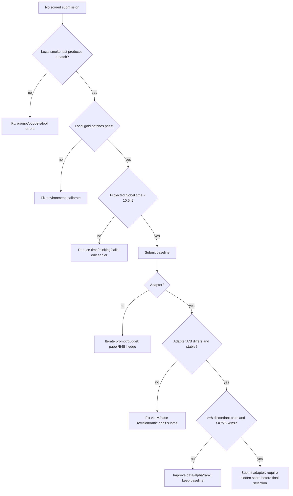

# 05 — Risks, Blockers, and Mitigations

This is the risk register for the full project: prompt-only baseline, local evaluation, post-training, adapter serving, and submission operations. Severity is **Critical / High / Medium / Low**; probability is a planning judgment, not a measured statistic. Evidence is cited; mitigations are concrete.

The two risks that lose the most work are **a broken local evaluator** and **a global 12-hour timeout**. Both have happened to public teams (S29, S31, S32, S39, S40). Treat them as primary, not edge cases.

---

## 1. Critical risks

### R1 — Global 12-hour timeout (no partial score)

**Severity:** Critical. **Probability:** High if budgets are not measured.

**Evidence:** The official limit is 12h for all tasks, inclusive of sandbox setup, excluding validation (S1). A participant reports a 22 October run ending with “Notebook Timeout” after ~12h, no partial score, daily slot used (S29). The public 0.22 notebook warns that its 8-minute per-task cap is not a guarantee of global completion (S37). A public entry once hit “Notebook Exceeded Allowed Compute” at a 5.5-minute cap (S40).

**Why it happens:** ~120 tasks × per-task mean + startup/setup. At 5 min mean, agent time is ~10h; at 5.5 min, ~11h; at 8 min, ~16h. Setup, model startup, and slow hidden-repo tests add more. Local timing under-estimates hidden-repo test time (S29).

**Detection:**

- Measure p50/p90/p95 task time on 20–40 holdout tasks.
- Project `startup + N × (setup + agent_mean)` with N≈120.
- Track the percentage of tasks hitting the per-task cap.
- Compare local timing to the scorer’s observed 8.9–11.9h runs (S29).

**Mitigation:**

- Use a per-task cap of 5–6 min as a starting point; 8 min only if mean is well below the cap.
- Reduce thinking budget and tool calls if mean is high.
- Make the prompt edit earlier (by call 12) so tasks finish sooner.
- Keep a known-good lower-budget bundle.
- Submit early; do not test timing on the final day.

**Residual risk:** Even a well-measured local run can be slower on hidden repos. Leave ≥15–20% headroom.

---

### R2 — Local evaluator is wrong (false confidence)

**Severity:** Critical. **Probability:** High with a plain notebook.

**Evidence:** A plain local setup resolved only 43/129 public gold patches; fastapi was 1/67 due to missing `typing_inspection`, wheel shadowing, and missing test deps (S31). A calibrated rebuild resolved 127/129 (S32). The starter notebook uses subprocess, 2 tasks, and sample budgets, and observed 0/2 `NO_PATCH` (S6). A public entry’s local 28/74 screening produced hidden scores of 0.17 and 0.10 for tied configs (S35). The same zip scored 0.10 and 0.15 (S39).

**Why it happens:** Python version mismatch, missing wheels, repo wheels shadowing the workspace, different pytest conventions, test/config edits, non-representative task subset, and noise.

**Detection:**

- Run gold patches in your environment. If they fail, the environment is wrong.
- Run an empty patch; if it resolves, the task is broken for local comparison.
- Check collection errors vs assertion failures.
- Compare local resolved tasks to the public leaderboard; large gaps indicate environment/selection issues.

**Mitigation:**

- Use a calibrated scorer-like sandbox (S32) or rebuild the environment with the missing test packages.
- Use Docker if available. If you have no sudo/Docker, use subprocess for smoke tests only; calibrate gold patches in a clean venv or a Kaggle CPU notebook, because subprocess is not scorer-identical (Python version/isolation differ).
- Hold out tasks/repos; don’t tune on all 129.
- Use paired comparisons and 30–40 tasks; treat 1–2 task differences as noise.
- Keep a run manifest (wheelhouse hash, Python version, model revision, prompt hash, seed).

**Residual risk:** Even a calibrated local environment is not the scorer. Hidden repos differ; local-to-hidden transfer is weak (S35, S39).

---

### R3 — Adapter loads but is ignored

**Severity:** Critical (wasted submission). **Probability:** Medium–High depending on vLLM build.

**Evidence:** Multiple users report Gemma 4 LoRA adapters loading successfully but producing byte-identical outputs; a vLLM PR fixed it (S23). The host has seen rank-64 adapters score (S26), but “scored” does not prove the adapter was active. The public LoRA experiment explicitly warns to verify the adapter is attached; vLLM logs label requests with the base model, so `/metrics` is not proof (S25).

**Detection:**

- A/B at temperature 0: base vs adapter outputs must differ.
- Restart the server and repeat; outputs should be stable.
- Check the served base revision matches the adapter’s training base.
- Check `adapter_config.json` target modules vs the model’s module names.
- Inspect the trace for adapter routing if available.

**Mitigation:**

- Use a vLLM build with the Gemma 4 LoRA fix; pin it.
- Pin the exact base revision used for training.
- Do not submit an adapter that has not passed A/B.
- Keep the prompt-only bundle as the second final submission.

---

### R4 — Adapter startup OOM / KV cache collapse

**Severity:** Critical. **Probability:** Medium; depends on rank/adapters/vLLM.

**Evidence:** With old defaults (`max_loras=8`, `max_lora_rank=128`), a single sample adapter reduced KV cache from 46,048 to 7,600 tokens; prompts >7.6k hung (S27). Root cause: LoRA CUDA graphs captured twice and not budgeted; `VLLM_MEMORY_PROFILER_ESTIMATE_CUDAGRAPHS=1` fixes it (S26). After the host patch, a rank-16 adapter served 28k prompts but KV cache dropped 36,432 → 27,712 at util 0.80 (S27). The host later made LoRA params dynamic; fewer adapters/lower rank leave more KV (S26).

**Detection:**

- Server startup log: sampler warm-up OOM or `GPU KV cache size`.
- Long-prompt test (~28k tokens) completes vs queues.
- `Notebook Threw Exception`/timeout after adding an adapter.

**Mitigation:**

- Set `VLLM_MEMORY_PROFILER_ESTIMATE_CUDAGRAPHS=1` in local serving; the scorer’s notebook does (S6:20).
- Use one adapter, rank 8–16; avoid multiple adapters.
- Test 28k prompts; keep compaction at 14,336.
- If startup OOM persists, submit without the adapter; do not burn slots.

---

### R5 — W4A16 LoRA instability / weak adapter

**Severity:** High. **Probability:** Medium for rank ≥32; lower for rank 8–16.

**Evidence:** An upstream vLLM issue on a compressed-tensors W4A16 model found rank-32 all-layer adapters weak/non-reproducible, rank-16 reproducible, rank-8 partial coverage stable (S24). This is not Gemma-specific, but the competition base is W4A16. The host has seen rank-64 adapters score (S26), but effectiveness is not established.

**Detection:**

- Temperature-0 outputs across restarts; identical prompts should be stable.
- Compare adapter strength to a reference/merged adapter if possible.
- Test rank 8/16 and partial coverage; rank 32 only if needed, with reproducibility checks.

**Mitigation:**

- Start rank 8–16; all seven projections or partial last layers.
- Test reproducibility before a submission.
- If unstable, lower rank or restrict coverage; if still unstable, do not submit the adapter.

---

### R6 — LoRA alpha scaling degenerates the agent

**Severity:** High. **Probability:** High if alpha/r is high.

**Evidence:** Public 31B LoRA experiment: alpha 32/r16 = scale 2.0 caused 257 s before first tool call, repeated `git log`, no edit, score 0; alpha 16 = scale 1.0 loops gone but more thinking/time; alpha 8 = scale 0.5 safest/fastest but weaker correction (S25).

**Detection:**

- Time to first tool call/edit.
- Repeated-call streaks.
- Thought length.
- Patch rate.
- Compare alpha 8/16 (scale 0.5/1.0) at rank 16; alpha 32 is a diagnostic.

**Mitigation:**

- Train with alpha = rank (scale 1.0).
- Sweep alpha at inference; alpha is in `adapter_config.json`, no retraining.
- If scale 1.0 is too slow, try 0.5; if too weak, try 1.0/1.5, not 2.0 blindly.

---

### R7 — Thinking-mode mismatch

**Severity:** High. **Probability:** High if data generation and inference differ.

**Evidence:** Public LoRA trained on trajectories with no thinking, but inference used thinking 4096; at alpha 16 it produced 2.5k–14.7k-character thought blocks and timeouts (S25). The public prompt-only baseline (author-reported 0.24) uses thinking 4096 (S36). S10 uses the thinking template for 31B/26B and the non-thinking `gemma-4` template for small models.

**Detection:**

- Inspect training samples for thought tokens.
- Inspect inference traces for thought length.
- Compare time/patch rate with thinking on/off.

**Mitigation:**

- Generate trajectories with the same thinking mode as inference.
- Include thought tokens in labels/context if inference keeps them.
- Or disable thinking at both training and inference.
- Do not mix.

---

### R8 — Training data is too small/weak or leaks

**Severity:** High. **Probability:** High for a first LoRA.

**Evidence:** 697 per-call samples/99 tasks did not beat the base (S25). Successful trajectories can contain redundant/risky steps (S19). Public wheel copies can leak fixes; stronger models sometimes read them outside `/workspace` (S31). External data rules require public/equally accessible data (S3).

**Detection:**

- Adapter loses to base in paired eval.
- Trajectories contain test/config edits, outside-workspace reads, or long loops.
- Data size <300 trajectories.
- Hidden score worse than prompt-only.

**Mitigation:**

- Filter by outcome, efficiency, style, hygiene, leakage.
- Use SRFT/SWE-Prime-style step/segment selection (S18, S19).
- Generate with thinking and exact tools.
- Hold out repos/tasks.
- Publish dataset/code; check licenses.

---

## 2. High risks

### R9 — Queue delays and daily quota loss

**Severity:** High. **Probability:** High during peak.

**Evidence:** Queue delays ~33h, later ~14h; pending submission limit; losing a daily slot is possible (S30). One submission/day; up to two final (S3). Failed runs can consume a slot (S29, S30).

**Mitigation:** Submit early; keep a known-good bundle; check queue before experiments; don’t submit on the last day; plan 2–3 scored runs/week.

---

### R10 — Infrastructure “Notebook Threw Exception”

**Severity:** High. **Probability:** Medium.

**Evidence:** Unchanged bundles failed with “Notebook Threw Exception” around 2026-10-21; possible vLLM startup >1200s; staff reprocessed some (S30). The starter sets `VLLM_ENGINE_READY_TIMEOUT_S=1200` (S6:19). A rank-64 adapter submission failed at startup while the same files worked locally (S26).

**Mitigation:** Keep adapter small; test startup; monitor forum; don’t resubmit blindly; keep baseline.

---

### R11 — Hidden score variance / public-private split

**Severity:** High. **Probability:** Certain.

**Evidence:** [COMMUNITY] Identical files 0.12–0.22 public in one study (S34); same zip 0.10/0.15 (S39); local screening not predictive (S35); public LB 50%, final private 50% (S4).

**Mitigation:** Paired local eval; two diverse final submissions; don’t overfit one score; treat ±2 tasks as noise.

---

### R12 — Prompt-only baseline is already strong (author-reported 0.24 public)

**Severity:** High for a post-training project. **Probability:** Certain.

**Evidence:** Public prompt-only notebook claims 0.24 (S36; author-reported). A LoRA must beat a strong scaffold, not a weak one. The public 1,500-trajectory LoRA did not (S25).

**Mitigation:** Reproduce the public prompt-only baseline (author-reported 0.24) first; define a clear win criterion; keep the baseline as a final slot; use the paper track if post-training fails.

---

### R13 — FSDP + QLoRA / Gemma 4 multi-GPU support

**Severity:** High. **Probability:** Medium–High.

**Evidence:** Axolotl FSDP+QLoRA docs list only llama/mistral/mixtral (S14). Gemma 4 FSDP has reported FQN/gradient issues in other frameworks (S50). BF16 LoRA + FSDP2 is the more likely path (S13), but still needs a smoke test.

**Mitigation:** Start single-GPU QLoRA; use 4 GPUs for parallel single-GPU runs; only then try FSDP2 BF16 LoRA; keep 12B/E4B as fallback.

---

### R14 — Gradient spikes / training instability

**Severity:** High. **Probability:** Medium.

**Evidence:** Gemma 4 text attention uses `scaling=1.0` with QK-RMSNorm; LoRA runs hit pre-clip gradient norms 100–1000× neighbors; 31B configs use LR 5e-5 and max_grad_norm 0.1 (S11).

**Mitigation:** LR 5e-5, max_grad_norm 0.1, cosine, warmup 0.1, monitor grad norm; stop/reduce LR if spikes.

---

### R15 — Model revision mismatch

**Severity:** High. **Probability:** Medium.

**Evidence:** Serving a different revision of the same repo silently cost quality (15/17 → 17/17) (S23). Training base and serving base must be pinned.

**Mitigation:** Record HF revision/commit for training and serving; use the same tokenizer/template; A/B.

---

## 3. Medium risks

### R16 — Tool-call parser loses arguments

**Severity:** Medium–High. **Probability:** High with large edits.

**Evidence:** Gemma 4 uses special tokens, not JSON; malformed quoting can swallow the next argument; 60/234 `edit_file` and 20/255 `write_file` calls rejected in one report (S30 thread). The public prompt-only prompt says split edits and never repeat failed calls (S36).

**Mitigation:** Small edits; simple args; inline Python replace after two failures; thinking; no identical retries.

---

### R17 — Compaction loses tool results/instructions

**Severity:** Medium. **Probability:** Medium.

**Evidence:** Community report; host said they would look into it (S28). Compaction threshold 14,336 (S5:518-521).

**Mitigation:** Short prompt; small reads; sub-agent; repeat finalization rule; avoid long histories.

---

### R18 — Test/config edits stripped

**Severity:** Medium. **Probability:** High for agents that “fix tests.”

**Evidence:** Protected hunks stripped; test paths reset (S5:535,549,556). Public prompt explicitly forbids test edits (S36).

**Mitigation:** Prompt rule; final `git status`; source-only changes.

---

### R19 — Scratch files pollute the patch

**Severity:** Medium. **Probability:** High.

**Evidence:** `git add -N .` includes untracked files; scratch in `/workspace` enters the patch (S5:625).

**Mitigation:** `/tmp` only; final `git status --short`; remove scratch.

---

### R20 — 3 GiB / adapter size limit

**Severity:** Medium. **Probability:** Low–Medium.

**Evidence:** Unpacked <3 GiB; rank 128 adapter 0.9–1.8 GB (S5:115,201). Multiple adapters can exceed.

**Mitigation:** One adapter, rank 8–16; check `du -sh`; zip unpacked size.

---

### R21 — Offline environment / missing dependencies

**Severity:** Medium. **Probability:** Medium locally; low on scorer.

**Evidence:** No internet; deps preinstalled (S5:235). Public wheel gaps caused gold failures (S31). Host says hidden tasks validate 100% (S31).

**Mitigation:** Don’t pip install; calibrate local env; treat collection errors as environment issues.

---

### R22 — Python/test-runner convention mismatch

**Severity:** Medium. **Probability:** Medium.

**Evidence:** Phase 2 uses `PYTHONSAFEPATH=1`, `PYTHONNOUSERSITE=1`, `-p no:anyio`, `python_classes="Test* *Test"` (S5:559-562). Some real fixes may fail under these conventions.

**Mitigation:** Use the same command locally; don’t “fix” the runner; focus on source behavior.

---

### R23 — Submission zip layout/symlinks/extensions

**Severity:** Medium. **Probability:** Low–Medium.

**Evidence:** Exactly one root config; no symlinks; allowed extensions; <3 GiB (S5:84,115,130). Starter validates (S6:593-611).

**Mitigation:** `cd agent && zip .`; `unzip -l`; `validate_directory`; remove `.DS_Store`/`__MACOSX`.

---

### R24 — Daily quota / pending submission blocks iteration

**Severity:** Medium. **Probability:** High.

**Evidence:** One/day; pending limit; queue (S3, S30).

**Mitigation:** Local screens; submit only meaningful changes; plan cadence.

---

### R25 — Compute cost/storage overrun

**Severity:** Medium. **Probability:** Medium.

**Evidence:** 31B BF16 ~62 GB, CT ~17.5 GB, data 22.42 GB; training tens of GPU-hours [ESTIMATE] (S7, S2).

**Mitigation:** Preflight disk/RAM; cache models; delete checkpoints; measure tokens/s; set a budget cap.

---

## 4. Low risks / watch items

| Risk | Evidence | Mitigation |
|---|---|---|
| Async functions missing from graphs | Host: private tasks don’t touch async (S33) | Don’t rely on graph for async public tasks |
| Graph tools unhelpful | Public audits (S36–S38) | Test; remove if not useful |
| 12B slower per task than expected | S34 | Use 31B; 12B only for pipeline |
| E4B weak | 0/31 in one comparison (S34) | Use only for small-model bonus |
| Public wheel leakage | Stronger models read fixed copies (S31) | Drop outside-workspace trajectories |
| License/data rules | S3 | Publish data/code; check licenses |
| Winner disclosure | S3 | Keep manifests/configs/hashes |
| Version drift | Evaluator changed repeatedly (S39) | Pin wheelhouse/vLLM; record hashes |
| Host patches change behavior | S26, S27, S28 | Re-run gold/A-B after updates |
| Score display truncation | Two decimals (S4) | Don’t overinterpret 0.01 differences |

---

## 5. Blocker decision tree

---

## 6. What to do when a run fails

1. **Preserve the artifacts.** Do not delete the results directory.
2. **Classify the failure:** no patch, patch apply, test failure, timeout, startup, queue, adapter ignored, environment.
3. **Check the trace:** first tool call, first edit, repeated calls, budget, context errors.
4. **Check the test log:** collection error vs assertion failure.
5. **Check the environment:** gold patch in the same sandbox.
6. **Change one thing.** Re-run a paired comparison.
7. **Record the result** in the experiment log.
8. **Do not resubmit blindly**; daily slots are scarce.

---

## 7. Risk review cadence

- **Daily:** GPU health, queue, submission status, known-good bundle.
- **Before each submission:** zip validation, adapter A/B, projected time, final selection slots.
- **Weekly:** re-read host posts; check wheelhouse/vLLM changes; re-run gold patches; review score variance.
- **Before final deadline:** two selected submissions, both scored; no pending runs; known-good bundle backed up; data/code/license ready if winning.
